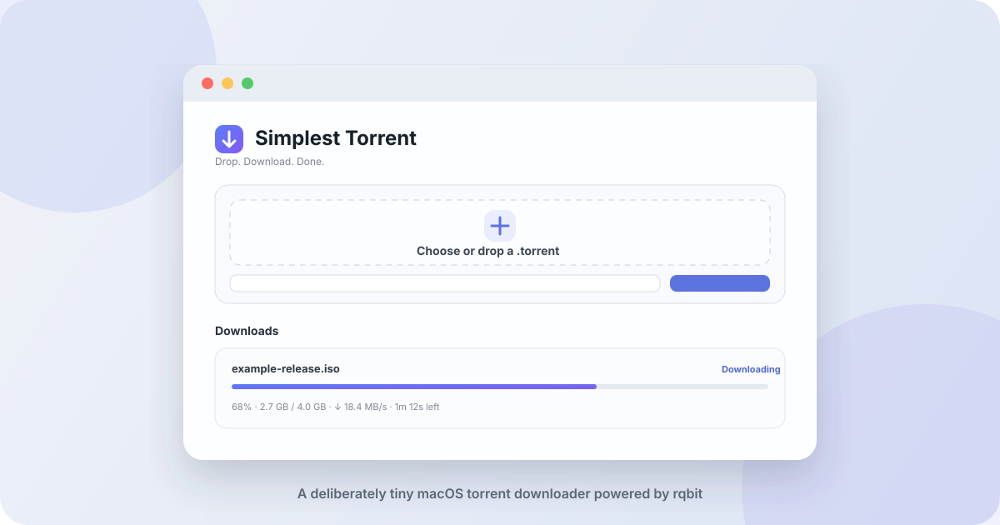

# Simplest Torrent

<p align="center">
  
</p>

<p align="center">
  <a href="https://github.com/myldy20/Simplest_torrent_downloader/releases/tag/v0.1.0-alpha.1"></a>
</p>

<p align="center">
  
  <a href="LICENSE"></a>
  
</p>

A deliberately tiny torrent downloader for macOS.

Choose a `.torrent` file, drop it onto the window, or paste a magnet link. The download starts immediately. No browser UI, setup wizard, media server, statistics cockpit, or other distractions.

This is the client for the moment when you need to download a 100 MB file and launching a full torrent application feels excessive.

## Download and install

The current build supports **Apple Silicon Macs**: M1, M2, M3, M4 and newer.

1. Open the [v0.1.0-alpha.1 release](https://github.com/myldy20/Simplest_torrent_downloader/releases/tag/v0.1.0-alpha.1).
2. Download the `.dmg` file.
3. Open it and move **Simplest Torrent.app** to `/Applications`.
4. The alpha is not signed or notarized yet. Open Terminal once and run:

```bash
xattr -dr com.apple.quarantine "/Applications/Simplest Torrent.app"
open "/Applications/Simplest Torrent.app"
```

This removes quarantine only from Simplest Torrent. It does **not** disable Gatekeeper globally.

## Use it

- click the large area to choose a `.torrent` file;
- or drag a `.torrent` file onto the window;
- or paste a magnet link and click **Download**;
- use the gear button to change the destination folder;
- pause, resume or remove a download from the list.

The default destination is your macOS `Downloads` folder. Enter an absolute path such as:

```text
/Users/your-name/Downloads/torrent
```

Missing folders are created automatically. Changing the destination affects new downloads; files already downloaded stay where they are.

## Intentionally small feature set

- `.torrent` files and magnet links;
- immediate download to a configured folder;
- progress, speed and remaining time;
- pause and resume;
- session restore after restarting the app;
- automatic stop after completion;
- remove from the list without deleting downloaded files.

That is intentionally almost the entire product.

## Current status

**0.1.0-alpha.1** is an early public alpha, tested on an Apple Silicon Mac.

Known limitation: the application is currently distributed without an Apple Developer ID signature or notarization, so the one-time Terminal command above is required on recent macOS versions.

The torrent engine is the mature Rust implementation from [rqbit](https://github.com/ikatson/rqbit). Simplest Torrent replaces its full desktop interface with a focused one-window workflow.

## Privacy and behaviour

- downloads go directly to the selected local folder;
- unfinished downloads are remembered;
- the optional local HTTP API is disabled on new installations;
- completed torrents are paused automatically instead of seeding indefinitely;
- removing a row keeps the downloaded files.

BitTorrent exchanges data with peers while a download is active. Use the application only for content you are authorized to download and share.

## Build locally

Requirements:

- current stable Rust toolchain;
- Node.js 22 or newer;
- npm;
- Xcode Command Line Tools.

```bash
npm ci
npm run build --workspace desktop
npm run tauri --workspace desktop -- build
```

For development:

```bash
npm ci
npm run tauri --workspace desktop -- dev
```

## Architecture

```text
Simplest Torrent
├── desktop/                 focused Tauri + React application
├── crates/librqbit/         embedded torrent session and API
├── crates/dht/              DHT implementation for magnet links
├── crates/*                 rqbit protocol and storage components
└── docs/                    project artwork and documentation
```

The interface communicates directly with the embedded `librqbit` session through Tauri commands. The upstream Web UI and local HTTP API are not required.

## Upstream and licensing

This repository is a downstream fork of [ikatson/rqbit](https://github.com/ikatson/rqbit).

The codebase remains under the **Apache License 2.0**. The original copyright notice and license remain with redistributed source and binaries. Project-specific modifications and attribution are documented in [THIRD_PARTY_NOTICES.md](THIRD_PARTY_NOTICES.md).

Apache-2.0 permits modification, redistribution and commercial use. It does not permit removing upstream attribution or implying upstream endorsement.

## Contributing

The product principle is simple: every new control must justify the attention it consumes. See [CONTRIBUTING.md](CONTRIBUTING.md).
